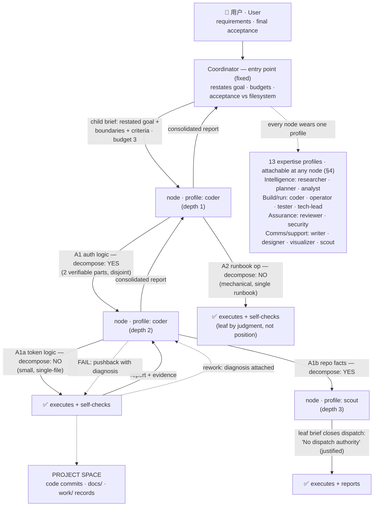
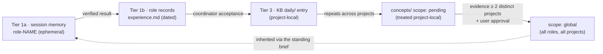

# AGENT ORG — One Agent Type, Dynamic Decomposition

> Proposal v1.3 · 2026-11-11 · implements the user directives of 2026-11-11. v1.2
> corrected v1.0/v1.1's fixed pyramid (**layers are NOT predefined**); v1.3 grows the
> roster to **thirteen expertise profiles** (adds tester, security, analyst, tech-lead —
> Google-engineering-org inspired) and adds within-profile axes (§4). One agent type;
> every node applies the same first-principles rule (§2): restate the goal, then
> decompose-or-execute. Below the coordinator the org is a **dynamic recursion tree** —
> depth decided per node, bounded only by `PI_SPAWN_BUDGET`; profiles attach at any node
> (§4). Mechanisms kept: UP-CHECK rework loop (§3), node conventions (§5), three-tier
> memory (§6), anti-patterns (§7). Proposal only — no other file changed. On acceptance
> it supersedes the "children must not delegate" line in `DELEGATION-ROUTING.md`; §5.2
> joins all thirteen role cards.

## 1. Org chart — a recursion tree, not a pyramid

Two entry pipelines are unchanged: the **subagent pipeline** (direct, in the
coordinator's own project) and the **project pipeline** (coordinator →
`pi-project-coordinator` → project primary; deliverables land in the project space per
`PROJECT-SPACE-STANDARD.md`). Below the entry coordinator there are no fixed layers:
the tree is grown per requirement by nodes applying the §2 test — the diagram below is
ONE requirement's shape, not the org chart. Only two things are fixed: the user on top
(requirements, final acceptance) and the coordinator entry point (restatement, budgets,
filesystem acceptance). Solid = dispatch / UP-CHECK report; dashed = rework.



Depth is decided per node by the decomposition test (§2), never by position: another
requirement may stop at depth 1 everywhere or run deeper on every branch.
`PI_SPAWN_BUDGET` per agent is the only bound. Instances are per
(role × project × engagement) — `role-coder@medical`, `role-coder@blog` —
instantiated on demand, fully async (§5.1).

## 2. The node decision rule — decompose or execute

ONE rule applies identically at every node — the coordinator at the root, a depth-1
coder node, a depth-3 scout node. Every agent, on receiving a goal, runs:

1. **Restate** — the goal in your own words: what is actually needed and why; any
   divergence from the literal instruction is flagged upward, never silently obeyed.
2. **Judge — the decomposition test**, answered from first principles, not position:
   - Can the work be split into sub-goals that are each **independently verifiable**
     (own acceptance criteria, checkable without the others)?
   - Are the sub-goals **disjointly owned** (separate files or isolated copies, no
     shared writes)?
   - Do **context and budget favor delegation** — is my remaining context better
     spent integrating than holding per-item detail, and is budget left for children?
   - Is the work mechanical, parallelizable, or per-item context-heavy (→ delegate),
     vs small, single-file, or dependent on my accumulated session context (→ execute)?
3. **YES → decompose.** Spawn child subagents; each brief = the restated sub-goal +
   ownership boundaries + acceptance criteria fixed before dispatch (never weakened,
   identical for all BoN candidates). **Every child gets the same rule** — recursion
   continues as deep as the problem structure requires; depth is unbounded,
   `PI_SPAWN_BUDGET` per agent the only bound.
4. **NO → execute.** Do the work yourself, self-check against the criteria, report up.
   §3 UP-CHECK runs at every edge — after executing and after consolidating children.

A node that cannot restate the goal or derive criteria escalates (`blocked` + one
concrete question) instead of dispatching a brief it does not understand.

## 3. UP-CHECK — the rework loop

A named mechanism, run at every edge of the tree (§1): delivery moves up one hop at a
time; each parent verifies before passing anything further up.

1. **Complete** — the child finishes the work inside its brief.
2. **Self-check** — the child tests itself against the brief's acceptance criteria
   (runs the tests, renders, reads back) and attaches evidence. A report without
   self-check evidence is incomplete, never a PASS.
3. **Report up** — verdict + evidence paths (child → parent; a parent that delegated
   consolidates per §5.3).
4. **Verify** — the parent re-checks the claim against real evidence (runs the tests,
   inspects the diff, reads the files). A child's PASS is a claim, not acceptance.
5. **Branch** — pass → consolidate and move up one level; fail → **push back down with
   a specific diagnosis**: which criterion failed, observed vs expected, the required
   change. A pushback without a diagnosis ("just redo it") is forbidden. The
   coordinator's rejection of a child's consolidated report is this same pushback
   (the node reworks itself or its children); the user remains the final acceptance
   point.
6. **Rework** — the child fixes and re-enters at step 2; prefer steering the live child
   (`subagent_message`) over re-spawning, unless its context is compromised.

**Two-strike rule.** After 2 failed rework rounds on the same criterion, stop and
escalate to a human with the evidence bundle (diagnoses, attempts, artifacts) — the
existing two-strikes doctrine. The loop ends only when top-level acceptance passes:
coordinator (filesystem-verified), then user (final).

## 4. Expertise profiles — attachable at any node

The thirteen roles are **expertise profiles, not layers or positions**. A profile changes
skills, standards, and the tool allowlist — never dispatch rights: any node may spawn
children (budget-bounded) and any node may carry any profile. A coder node spawns
scout children for repo facts; a reviewer node spawns focused reviewers per concern.
"Typical children" = what a node wearing this profile usually spawns; deviation is a
judgment, not a violation. There is no separate "worker" row: a spawned agent is the
same node type — its profile sets skills, its brief sets boundaries (§5.2).

Escalation is uniform: a `blocked` report with one concrete question to the parent;
never self-authorize, never retry unknown outcomes. "BoN" = best-of-N; a fanout of N
counts N against the budget. Every node is proposal-only on acceptance, scope, budget,
and authorization — those belong to the dispatching parent and, finally, the
coordinator entry point.

| Profile | Typical children | Reports to | Escalates when | Authority | Budget / task |
|---|---|---|---|---|---|
| scout | none typical (reads itself) | parent | gaps found | proposal-only (facts) | 0 |
| researcher | ≤2 scout (repo-side facts) | parent | claims unverifiable | proposal-only | ≤2 |
| planner | ≤2 scout (verify load-bearing assumptions) | parent | plan needs a decision | proposal-only (plan ≠ authorization) | ≤2 |
| analyst | ≤1 scout (locate datasets, metric definitions) | parent | data provenance unverifiable | proposal-only (analysis + verdicts) | ≤1 |
| coder | coder ×3 BoN (≤5 hard) + 1 scout recon | parent | scope/auth overflow; blocked verification | bounded execution in file scope; *recommends* a candidate | ≤5 |
| operator | operator per runbook segment | parent | unknown outcomes; runbook vs reality mismatch | runbook execution + **stop authority** on gate failure | ≤3 |
| tech-lead | workers per §5.2 default (subtree decomposition) | parent | acceptance/scope beyond its subtree | subtree direction; *recommends*, never self-accepts | budget-bounded (brief wins) |
| tester | ≤2 scout (repo + test-suite facts) | parent | asked to weaken tests | bounded execution in test scope; never weakens tests | ≤2 |
| reviewer | reviewer focused passes (correctness/security/regression) | parent | blocking finding | proposal-only (graded findings) | ≤3 |
| security | ≤1 scout (dependency/attack-surface facts) | parent | exploitable finding needs a decision | proposal-only (graded findings) | ≤1 |
| writer | writer per doc/section | parent | audience/destination ambiguity | bounded execution in doc scope | ≤2 |
| designer | designer per artifact | parent | ugliness is structural | presentation-only execution | ≤2 |
| visualizer | visualizer per artifact | parent | data missing/ambiguous | new-artifact-only execution | ≤2 |

## 5. Node conventions — sessions, dispatch, reporting

### 5.1 Session and lifecycle
- **Session id = `role-<name>@<project>`** (e.g. `role-coder@medical`) — a
  profile×project resume key, not a tier membership; plain `role-<name>` when no
  concurrent same-role task exists. Created on first instruction via `subagent_spawn`
  (always background), resumed via the `session` arg; naming rules → below.
- **Standing brief = the role's `AGENTS.md` + its `records/experience.md`** (§6). The
  instance reads both and its own skills first, then the task brief. Continuity is the
  the point: budgets spent, candidate rankings, child quality, and project quirks
  persist across dispatches.
- **Memory is layered (§6)**: this session is tier-1(a) ephemeral; durable lessons go
  to tier-1(b) `records/experience.md` only after a verified result; project facts stay
  in tier-2; global reach only through the tier-3 KB scope gate.
- **Instantiated on demand, never resident.** A resumed agent is a saved session, not a
  running process: spawned when an instruction arrives, idle after reporting up. No
  polling, keepalive, scheduled wake-ups, or waiting for work; resuming with no new
  instruction does nothing.
- Model discipline unchanged: agents inherit the session provider (worker
  default per `~/.pi/agent/AGENTS.md`) unless the user authorizes a change; the brief
  states the model for every spawn.

**Concurrency & namespacing — async by default.** Every dispatch is background:
`subagent_spawn` returns immediately and consolidated reports arrive as new messages —
no node ever blocks its turn on a chain; it routes, releases attention, and acts on
the report when it arrives.

1. **One active task per session.** An instance serializes its own work; concurrent
   dispatches to the same session id are forbidden (the router creates another
   instance instead).
2. **Same role + different projects, concurrently → separate instances** by
   namespacing: `role-coder@medical`, `role-coder@blog`. Same expertise, isolated
   working memory; durable knowledge stays SHARED via tier-1b `records/experience.md`
   and tier-3 KB — §6 already separates working state from durable capability.
3. **Same role + same project + concurrent tasks → suffixed instances**
   `role-<name>@<project>-2`, `-3` (or task-scoped ids), each with disjoint file
   ownership per the §2 decomposition protocol.
4. **The router derives the id mechanically** from (role, project, in-flight set) —
   never ask the user which instance to use.

### 5.2 `DISPATCH AUTHORITY` — default ON for every spawned agent
Dispatch authority is the **default** for every spawned agent, budget-bounded — a
property of being an agent in this org, not of a tier. A parent may close it only in
the child's brief with a stated justification (e.g. a BoN candidate must not
re-decompose the same task; a mechanical leaf). Every `instructions/agents/*/AGENTS.md`
gains this section immediately before "Task Brief":

```markdown
## Dispatch Authority
- DEFAULT: I may decompose and spawn child subagents (subagent_spawn), each briefed
  with restated goal + boundaries + acceptance criteria (§2) and this same rule.
- Budget: <n> spawns per dispatched task (a fanout of N counts N); a number stated in
  the parent's brief wins.
- Profile: this card's skills/standards govern me and, by default, the children I brief.
- Closed dispatch: a parent may write "No dispatch authority: execute and report" in
  my brief — it must justify the closure (BoN candidate, mechanical leaf). I apply the
  same bar before closing a child's dispatch.
- I must escalate (never self-authorize): acceptance, scope expansion, authorization
  changes, unknown outcomes, and cross-profile work beyond read-only support.
- Consolidation (when I delegated): exactly one final report — verdict, deliverable
  paths, evidence table (child → result → evidence path), open items; child transcripts
  referenced by path (.pi/subagents/<id>/), never pasted.
- Delegate vs do: the §2 test — decompose when independently verifiable, disjoint, and
  context/budget favors it; execute when small, single-file, or needing my session context.
```

### 5.3 Consolidated reporting — one report up, evidence attached
A node that chose to decompose (§2) spawns children with disjoint ownership, runs the
UP-CHECK loop per §3, and returns **exactly one** `ready` report to its parent: verdict
→ deliverable paths → evidence table → open items. Child evidence is attached *by path*
(logs, diffs, test output, `work/` RECORDs) so the parent can re-verify without reading
transcripts.

## 6. Memory architecture — three tiers, separate by design

Capability compounds only if memory is layered: per-agent, per-project, and global
memory are separate (user directive 2026-11-11). Infrastructure verified before citing:
`knowledge-base/AGENTS.md` (scope gate), `README.md` (pi-memory-index), the global
`~/.pi/agent/AGENTS.md` (coordinator registry/journal location).

| Tier | Scope | Where | Who reads | Who writes |
|---|---|---|---|---|
| **1 — Agent memory** | one agent (profile-keyed session) | (a) the resumable `role-<name>` session — ephemeral, dies with retirement; (b) `instructions/agents/<role>/records/experience.md` — durable, verified-results-only, committed to git, **keyed by PROFILE, not by tier** | the agent; children receive excerpts via the brief only | session: the agent; records: the coordinator entry appends dated entries after filesystem verification — nodes propose in their consolidated report, children flag |
| **2 — Project memory** | one project root | the project space itself — README/ADRs/runbooks/postmortems/`work/` records (per `PROJECT-SPACE-STANDARD.md`) + the per-project journal and registry (`~/.pi/agent/project-coordinator/`, private, documented in the global AGENTS.md) | any agent, **only when working that project** | executing nodes write `work/` RECORDs; the project primary refreshes README status, ADRs, runbooks |
| **3 — Global memory** | all projects | `knowledge-base/` — `daily/` log, `knowledge/concepts/` + `wiki/` — plus the cross-session FTS5 index (pi-memory-index: `memory_search` over distilled memory only — compaction observations, daily entries, concepts — project-scoped) | all roles | primary conversation appends `daily/` after verified results; concept promotion is gated (below); nodes propose only |

**Contamination rules.** A lesson learned in project A must never surface in project B
unless promoted through the KB scope gate (`knowledge-base/AGENTS.md`, "Concept scope
certification"): concept frontmatter carries `scope: global | pending | project:<name>`;
`pending` is treated as project-local and never retrieved globally; `scope: global`
requires `evidence:` citing **≥ 2 distinct projects** AND `approval: user-approved`,
enforced fail-closed (lint error, exit 1) by `scripts/compile_kb.py`. Tier-2 memory
never leaves its project root; tier-1(a) session memory is never cited as acceptance
evidence and dies with retirement.

**What qualifies as a lesson (tier 1b / 3):** a transferable insight from a **verified**
result that would change a future dispatch — a pitfall with its mechanism, an
acceptance criterion that caught a real defect, a budget or spawn heuristic validated
in practice. **What does not:** project-private details, secrets, one-off task state,
and unverified hypotheses (labeled as such or dropped).

**Promotion path — each arrow is a gate, not a copy** (the evolution loop of incident
→ verified fix → lesson → inheritance is this cycle read forward):



## 7. Anti-patterns

1. **Inline execution / bypassing the test.** A node executing delegatable work without
   running the §2 test — or decomposing without restating the goal and fixing criteria
   first. The coordinator is not exempt: below the user it is a node like any other.
   Narrow exception: a single bounded, no-follow-up check may be executed directly with
   the reason stated in the turn (mirrors `delegation_gate.py --exception`).
2. **Resident daemons.** Agents drifting into standing idle processes — polling,
   heartbeat loops, "watching" a project, or auto-resuming without an instruction.
   Resumed sessions exist between an instruction and their report; between tasks
   they are files on disk, not cycles on CPU.
3. **Self-acceptance.** A node marking its own consolidated output (or a child's
   PASS) as user-facing done. Acceptance authority **always** returns up to the
   dispatching parent and, finally, the coordinator entry point, which re-verifies
   against real files/tests — nodes propose and consolidate, never self-accept. The
   user is final.
4. **Pass-through relay.** A node that forwards briefs verbatim or concatenates
   child reports without restating goals, owning budgets, ranking candidates, and
   attaching evidence adds latency, not value — give it closed-dispatch leaf briefs
   in future dispatches (§8).
5. **Fixed-layer thinking.** Designing dispatch rights by tier — "coordinators and
   instances dispatch, workers execute" — instead of per-node decomposition judgment.
   Layers are emergent properties of one requirement's recursion; a node's right to
   decompose comes from the §2 test plus budget, never from position. (This
   document's v1.0/v1.1 pyramid was exactly this error; corrected 2026-11-11.)

## 8. Phased rollout

- **Phase 1 — pilot (coder, operator, reviewer).** Highest dispatch volume (coder),
  clearest chain semantics (operator), and the purest consolidation case (reviewer).
- **Phase 2 — researcher, planner, writer, analyst, security.** Support, communication,
  and proposal-graded analysis profiles, after the conventions have survived contact
  with real dispatches.
- **Phase 3 — tester, tech-lead, designer, visualizer, then retire tier-shaped defaults.**
  Tester rides the coder pilot's proven pattern; tech-lead exercises the full §5.2
  subtree machinery. Update
  `DELEGATION-ROUTING.md` (ownership = per-node §2 test + budget, not tiers), the
  role cards (§5.2 default-ON dispatch), and the work-record `Dispatched-by` field
  (node session id + depth).
- **Validation (per pilot profile, before promotion):** one real multi-level chain —
  coordinator → node → child (≥2 levels below the coordinator, uneven depths fine) —
  with evidence that (a) a session id was
  reused on a second dispatch (resumability), (b) exactly one consolidated report with
  child evidence paths arrived, (c) the parent independently re-verified the
  deliverable (diff/tests/filesystem), (d) `subagent_list` showed nothing resident after
  consolidation, (e) a `work/` RECORD names the chain (session ids + depths), and (f) at least one
  UP-CHECK rework round ran with a written diagnosis (or a deliberate one was
  demonstrated, if zero rework was genuinely needed).
- **Rollback rule:** if a pilot shows relay overhead without consolidation value, default
  that profile to closed-dispatch leaf briefs and record the decision as an ADR — the
  org serves the dispatch, never the reverse.
