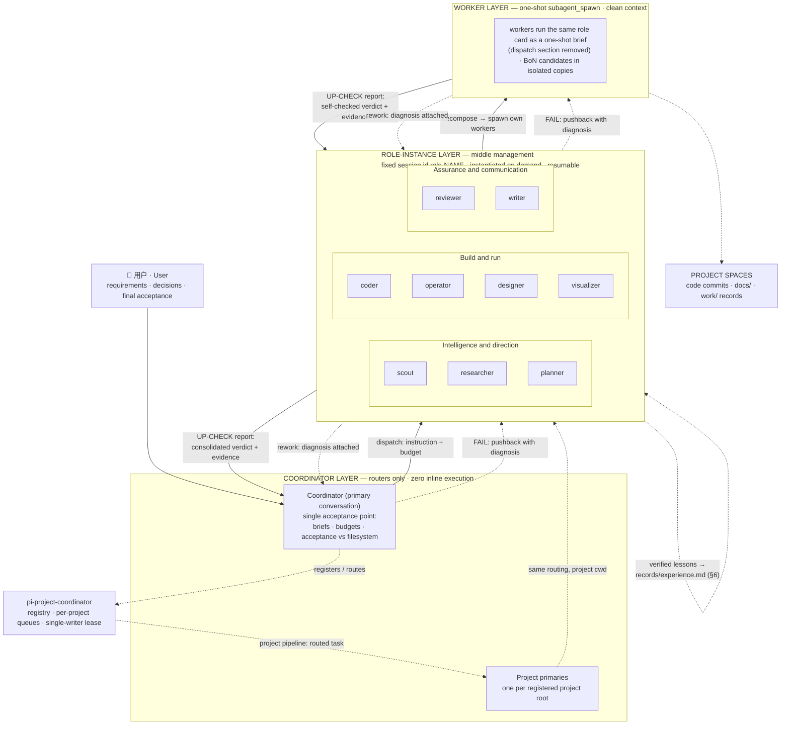
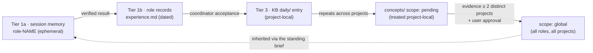

# AGENT ORG — Role Instances as Middle Management

> Proposal v1.1 · 2026-11-11 · implements the user directives of 2026-11-11. Predefined
> **role instances** (resumable, worker-spawning) sit between coordinator and workers,
> like middle management. The hierarchy exists to **recursively decompose** requirements
> (§2), run the **UP-CHECK rework loop** at every level (§3), and **compound capability**
> across dispatches (§6). Depth cap removed; the per-agent spawn budget (`PI_SPAWN_BUDGET`)
> is the only bound. Proposal only — no other file changed. On acceptance it supersedes
> the "children must not delegate" line in `DELEGATION-ROUTING.md`; §5.2 joins all nine cards.

## 1. Org chart

Two pipelines share one shape — coordinator layer routes, role instances manage, workers
execute: the **subagent pipeline** (direct; bounded work in the coordinator's own project)
and the **project pipeline** (coordinator → `pi-project-coordinator` → project primary →
role instances → workers; deliverables land in the project space per
`PROJECT-SPACE-STANDARD.md`). Solid = dispatch / UP-CHECK report; dashed = rework
(pushback down, diagnosis-bearing resubmission up), coordination, or lessons.



## 2. Decomposition protocol (first principles)

The org exists to recursively decompose a requirement, not to forward instructions.
Each level — coordinator → instance, instance → worker — re-derives *what is actually
needed and why* before dispatching. Before spawning any child, the dispatcher writes:

| Output | Requirement |
|---|---|
| **(a) Restated goal** | the goal in the dispatcher's own words — what is actually needed and why; any divergence from the literal instruction is flagged upward, never silently obeyed |
| **(b) Sub-goal split** | ≤6 sub-goals (planner convention), each with an explicit file/ownership boundary — disjoint files, no shared writes, best-of-N copies isolated |
| **(c) Acceptance criteria per child** | written **before** dispatch, fixed thereafter (never weakened to obtain a pass); per the project-space standard: code commits + doc updates where applicable |

- A worker brief is the **leaf** of this recursion — the parent's **(a) restated goal +
  (c) acceptance criteria** plus (b)'s boundaries, never a verbatim copy of the
  instruction (verbatim forwarding = pass-through relay, §7.4).
- A level that cannot restate the goal or derive criteria escalates (`blocked` + one
  concrete question) instead of dispatching a brief it does not understand.
- Depth is bounded only by budget (§5.1); every level repeats (a)–(c).

## 3. UP-CHECK — the rework loop

A named mechanism, run at every level: delivery moves up one level at a time; each level
verifies before passing anything further up.

1. **Complete** — the child finishes the work inside its brief.
2. **Self-check** — the child tests itself against the brief's acceptance criteria
   (runs the tests, renders, reads back) and attaches evidence. A report without
   self-check evidence is incomplete, never a PASS.
3. **Report up** — verdict + evidence paths (worker → instance; instance consolidates
   per §5.3 → coordinator).
4. **Verify** — the parent re-checks the claim against real evidence (runs the tests,
   inspects the diff, reads the files). A child's PASS is a claim, not acceptance.
5. **Branch** — pass → consolidate and move up one level; fail → **push back down with
   a specific diagnosis**: which criterion failed, observed vs expected, the required
   change. A pushback without a diagnosis ("just redo it") is forbidden. The
   coordinator's rejection of an instance's consolidated report is this same pushback
   (the instance reworks itself or its workers); the user remains the final acceptance
   point.
6. **Rework** — the child fixes and re-enters at step 2; prefer steering the live worker
   (`subagent_message`) over re-spawning, unless its context is compromised.

**Two-strike rule.** After 2 failed rework rounds on the same criterion, stop and
escalate to a human with the evidence bundle (diagnoses, attempts, artifacts) — the
existing two-strikes doctrine. The loop ends only when top-level acceptance passes:
coordinator (filesystem-verified), then user (final).

## 4. Relationship matrix

Escalation is uniform in *form*: a `blocked` report with one concrete question to the
dispatcher (workers → instance, instances → coordinator layer); never self-authorize,
never retry unknown outcomes. "BoN" = best-of-N candidates; a fanout of N counts N
against the budget. Every role instance is proposal-only on acceptance, scope,
budget, and authorization — those are coordinator-layer decisions.

| Role | Dispatches (worker cards) | Reports to | Escalates when | Authority | Budget / task |
|---|---|---|---|---|---|
| scout | none (reads itself) | dispatcher | gaps found | proposal-only (facts) | 0 |
| researcher | ≤2 scout (repo-side facts) | coordinator | claims unverifiable | proposal-only | ≤2 |
| planner | ≤2 scout (verify load-bearing assumptions) | coordinator | plan needs a decision | proposal-only (plan ≠ authorization) | ≤2 |
| coder | coder ×3 BoN (≤5 hard) + 1 scout recon | coordinator | scope/auth overflow; blocked verification | bounded execution in file scope; *recommends* a candidate | ≤5 |
| operator | operator per runbook segment | coordinator | unknown outcomes; runbook vs reality mismatch | runbook execution + **stop authority** on gate failure | ≤3 |
| reviewer | reviewer focused passes (correctness/security/regression) | coordinator | blocking finding | proposal-only (graded findings) | ≤3 |
| writer | writer per doc/section | coordinator | audience/destination ambiguity | bounded execution in doc scope | ≤2 |
| designer | designer per artifact | coordinator | ugliness is structural | presentation-only execution | ≤2 |
| visualizer | visualizer per artifact | coordinator | data missing/ambiguous | new-artifact-only execution | ≤2 |
| worker | none | dispatching role instance | anything outside its brief | execution within worker brief | 0 |

## 5. Role-instance conventions

### 5.1 Session and lifecycle
- **Fixed session id `role-<name>`** (e.g. `role-coder`), scoped to the dispatching
  coordinator; prefix with the project id when two coordinators could collide
  (`role-coder-medical-sim`). Created on first instruction via `subagent_spawn`,
  resumed thereafter via the `session` arg.
- **Standing brief = the role's `AGENTS.md` + its `records/experience.md`** (§6). The
  instance reads both and its own skills first, then the task brief. Continuity is the
  middle-management value: budgets spent, candidate rankings, worker quality, and
  project quirks persist across dispatches.
- **Memory is layered (§6)**: this session is tier-1(a) ephemeral; durable lessons go
  to tier-1(b) `records/experience.md` only after a verified result; project facts stay
  in tier-2; global reach only through the tier-3 KB scope gate.
- **Instantiated on demand, never resident.** A role instance is a saved session, not a
  running process: spawned when an instruction arrives, idle after consolidation. No
  polling, keepalive, scheduled wake-ups, or waiting for work; resuming with no new
  instruction does nothing.
- Model discipline unchanged: instances and workers inherit the session provider (worker
  default per `~/.pi/agent/AGENTS.md`) unless the user authorizes a change; the brief
  states the model for every spawn.

### 5.2 `DISPATCH AUTHORITY` section — required in every role card
Every `instructions/agents/*/AGENTS.md` gains this section immediately before
"Task Brief" (values per the §4 matrix):

```markdown
## Dispatch Authority
- Workers I may spawn: <role cards + typical counts>, via subagent_spawn with this
  AGENTS.md as the worker brief, this section replaced by: "No dispatch authority.
  You are a one-shot worker; report to your dispatching role instance."
- Budget: <n> spawns per dispatched task (a fanout of N counts N). A budget stated
  in the coordinator's brief always wins over this default.
- I may decide: <bounded list, e.g. implementation details inside the file scope>.
- I must escalate (never self-authorize): acceptance, scope expansion, authorization
  changes, unknown outcomes, and cross-role work beyond read-only scout/reviewer
  support.
- Consolidation: exactly one final report — verdict, deliverable paths, evidence
  table (worker → result → evidence path), open items. Worker transcripts are
  referenced by path (.pi/subagents/<id>/), never pasted.
- Delegate vs do: delegate when work is parallelizable, mechanical, or per-item
  context-heavy; do it yourself when small (<~15 min), single-file, or it needs
  this session's accumulated context.
```

### 5.3 Consolidated reporting — one report up, evidence attached
The instance decomposes per §2, spawns workers with disjoint ownership, runs the UP-CHECK
loop per §3, and returns **exactly one** `ready` report: verdict → deliverable paths →
evidence table → open items. Worker evidence is attached *by path* (logs, diffs, test
output, `work/` RECORDs) so the coordinator can re-verify without reading transcripts.

## 6. Memory architecture — three tiers, separate by design

Capability compounds only if memory is layered: per-agent, per-project, and global
memory are separate (user directive 2026-11-11). Infrastructure verified before citing:
`knowledge-base/AGENTS.md` (scope gate), `README.md` (pi-memory-index), the global
`~/.pi/agent/AGENTS.md` (coordinator registry/journal location).

| Tier | Scope | Where | Who reads | Who writes |
|---|---|---|---|---|
| **1 — Agent memory** | one role instance | (a) the resumable `role-<name>` session — ephemeral, dies with retirement; (b) `instructions/agents/<role>/records/experience.md` — durable, verified-results-only, committed to git | the instance; workers receive excerpts via the brief only | session: the instance; records: the coordinator layer appends dated entries after filesystem verification — instances propose in their consolidated report, workers flag |
| **2 — Project memory** | one project root | the project space itself — README/ADRs/runbooks/postmortems/`work/` records (per `PROJECT-SPACE-STANDARD.md`) + the per-project journal and registry (`~/.pi/agent/project-coordinator/`, private, documented in the global AGENTS.md) | any agent, **only when working that project** | workers write `work/` RECORDs; the project primary refreshes README status, ADRs, runbooks |
| **3 — Global memory** | all projects | `knowledge-base/` — `daily/` log, `knowledge/concepts/` + `wiki/` — plus the cross-session FTS5 index (pi-memory-index: `memory_search` over distilled memory only — compaction observations, daily entries, concepts — project-scoped) | all roles | primary conversation appends `daily/` after verified results; concept promotion is gated (below); workers propose only |

**Contamination rules.** A lesson learned in project A must never surface in project B
unless promoted through the KB scope gate (`knowledge-base/AGENTS.md`, "Concept scope
certification"): concept frontmatter carries `scope: global | pending | project:<name>`;
`pending` is treated as project-local and never retrieved globally; `scope: global`
requires `evidence:` citing **≥ 2 distinct projects** AND `approval: user-approved`,
enforced fail-closed (lint error, exit 1) by `scripts/compile_kb.py`. Tier-2 memory
never leaves its project root; tier-1(a) session memory is never cited as acceptance
evidence and dies with retirement.

**What qualifies as a lesson (tier 1b / 3):** a transferable insight from a **verified**
result that would change a future dispatch — a pitfall with its mechanism, an
acceptance criterion that caught a real defect, a budget or spawn heuristic validated
in practice. **What does not:** project-private details, secrets, one-off task state,
and unverified hypotheses (labeled as such or dropped).

**Promotion path — each arrow is a gate, not a copy** (the evolution loop of incident
→ verified fix → lesson → inheritance is this cycle read forward):



## 7. Anti-patterns

1. **Coordinator bypass.** Executing delegatable work inline, or spawning raw workers
   with a role card instead of routing through the role instance — both destroy
   consolidation and re-grow the primary context. Narrow exception: a single bounded,
   no-follow-up check may go direct with the reason stated in the turn
   (mirrors `delegation_gate.py --exception`).
2. **Resident daemons.** Role instances drifting into standing idle processes — polling,
   heartbeat loops, "watching" a project, or auto-resuming without an instruction.
   Instances exist between an instruction and its consolidated report; between tasks
   they are files on disk, not cycles on CPU.
3. **Self-acceptance.** An instance marking its own consolidated output (or a worker's
   PASS) as user-facing done. Acceptance authority **always** returns to the coordinator
   layer, which re-verifies against real files/tests — roles propose and consolidate,
   never self-accept. Project primaries accept for their project; the user is final.
4. **Pass-through relay.** An instance that forwards briefs verbatim or concatenates
   worker reports without restating goals, owning budgets, ranking candidates, and
   attaching evidence adds latency, not value — demote it back to a plain worker (§8).

## 8. Phased rollout

- **Phase 1 — pilot (coder, operator, reviewer).** Highest dispatch volume (coder),
  clearest chain semantics (operator), and the purest consolidation case (reviewer).
- **Phase 2 — researcher, planner, writer.** Support and communication roles, after
  the conventions have survived contact with real dispatches.
- **Phase 3 — designer, visualizer, then retire the direct-dispatch default.** Update
  `DELEGATION-ROUTING.md` (owner column gains "role instance"), the role cards (§5.2),
  and the work-record `Dispatched-by` field (adds the instance's session id).
- **Validation (per pilot role, before promotion):** one real two-level chain —
  coordinator → `role-<name>` → ≥2 workers — with evidence that (a) the session id was
  reused on a second dispatch (resumability), (b) exactly one consolidated report with
  worker evidence paths arrived, (c) the coordinator independently re-verified the
  deliverable (diff/tests/filesystem), (d) `subagent_list` showed nothing resident after
  consolidation, (e) a `work/` RECORD names instance + workers, and (f) at least one
  UP-CHECK rework round ran with a written diagnosis (or a deliberate one was
  demonstrated, if zero rework was genuinely needed).
- **Rollback rule:** if a pilot shows relay overhead without consolidation value, demote
  it back to a direct worker and record the decision as an ADR — the org serves the
  dispatch, never the reverse.
